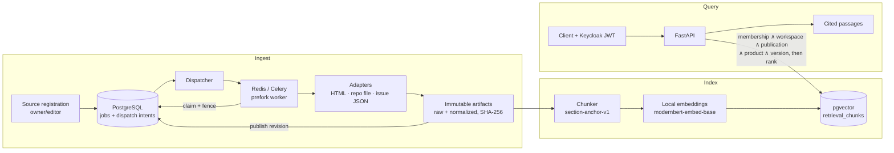

# DocLens

**A RAG service for engineering knowledge that tracks versions and checks access, with citations you can inspect.** DocLens ingests official documentation, pinned repository source and curated issue history. It keeps every passage tied to its product, release and exact source location. Searches return only evidence the caller is allowed to see, and only from the requested version.

The initial focus is practical file-processing questions for Python developers on 3.12 and 3.13. For example, *"Why can reopening a `NamedTemporaryFile` fail on Windows?"* or *"Which metadata can `copy2` still lose?"*

## What it does today

- **Answers with checked citations (CLI baseline).** `ask` retrieves version-scoped evidence and generates an answer through an explicit zero-cost OpenRouter model. It then validates the answer's structure and citations. If the evidence is too weak, it returns `insufficient_evidence` instead of guessing. Provider errors are reported separately from missing evidence.
- **Authenticated workspaces.** The FastAPI service verifies real Keycloak RS256 tokens and checks current PostgreSQL membership on every request. Owners and editors register sources; viewers can read and search. Requests for another workspace's data return 404, not 403, so they don't reveal that the data exists.
- **Recoverable ingestion.** Sync requests become durable PostgreSQL jobs. Celery/Redis workers claim jobs with fencing tokens, retry a bounded number of times, and publish immutable, hash-verified raw and normalized artifacts. Duplicate deliveries are safe. Exactly-once delivery is not promised.
- **Three source formats, each with honest provenance:**
  - Python HTML documentation, with section anchors and code whitespace preserved.
  - A CPython test file pinned to a commit, with exact line-range citations.
  - A curated historical issue export, with attributed summaries, comment links, the historical release scope and explicitly unknown dates.
- **Scoped vector search.** PostgreSQL + pgvector exact cosine search. Membership, workspace, current publication, product and version filters are applied in the *same SQL statement* as the ranking. Removing someone's access takes effect immediately and needs no re-embedding.
- **Measured evaluation.** A source-checked development set, a held-out split that stays reserved, and saved per-query reports. Retrieval quality and answer quality are measured separately from backend tests.

## Architecture



The code is one layered package with ports and adapters: pure `domain` logic at the center, application packages (`sources`, `ingestion`, `retrieval`, `answers`) around it, and thin `api`/`worker` interfaces at the edge. PostgreSQL/pgvector is the single store; the original SQLite pipeline lives in `legacy/` until the unified CLI replaces it. Application code handles authorization, provenance, stable IDs, revision publication and citation validation. Libraries provide transport, parsing, storage and vector math. See the [module map](docs/architecture.md#module-map) and the [expanded plan](docs/expanded-rag-plan.md).

## Results

| Check | Result | Evidence |
| --- | --- | --- |
| Dev retrieval, single-release questions (19) | Section recall@5 **0.974**, MRR@5 **0.895**, group recall@5 **1.0** | [baseline](evals/baseline-dev.md) |
| Dev retrieval, version-comparison questions (2) | Section recall@5 0.75, MRR@5 0.44: a known weakness, kept for Stage 7 | [baseline](evals/baseline-dev.md) |
| Wrong-version passages returned | **0 / 130** | [Stage 4 comparison](evals/stage4-pgvector-dev.md) |
| pgvector vs SQLite baseline | **26/26 identical rankings**, max score difference 1.9e-7, 1,474/1,474 identical chunks | [Stage 4 comparison](evals/stage4-pgvector-dev.md) |
| Live answer sample (4 dev questions) | 2 answered, 2 correct evidence-gap responses, $0 model cost; review found weak citation placement | [review](evals/generation-dev-review.md) |
| Full test suite (Stage 3, macOS) | **344 passed**, with real PostgreSQL, Keycloak, Redis and Celery worker processes | [Stage 3 issues](docs/stage3-issues.md#acceptance-and-verification) |
| Stage 4 retrieval tests (Windows) | 8 real PostgreSQL/pgvector + 16 offline cases passed | [Stage 4 guide](docs/stage4-retrieval.md) |

**Limits:** The labels were written by the assistant and have not had independent human review. The dev set is small. The v2 grounding prompt has only been verified offline, not live. On Windows, 13 integration tests and 1 setup error come from known platform portability issues (`O_NOFOLLOW`, `killpg`, CRLF hashing, SQLite file locks), not from Stage 4. Authorization is application-scoped SQL, not row-level security. These checks show the stated behavior; they do not establish production security or general answer accuracy.

## Status

| Stage | Deliverable | Status |
| --- | --- | --- |
| 0: Plan | Product, acceptance matrix, library ownership, migration plan | ✅ Complete |
| 1: Workspace ownership | Authenticated API, PostgreSQL migrations, memberships, source registration | ✅ Verified with real Keycloak/PostgreSQL |
| 2: Ingestion workflow | Persisted jobs, Celery/Redis, verifiable snapshots, recovery | ✅ Verified, including real worker fault tests |
| 3: Source/format units | Pinned repository file, curated issue export | ✅ Selected units verified; Markdown/PDF only when useful material exists |
| 4: Retrieval | Scoped PostgreSQL/pgvector exact search API | ✅ Verified locally |
| 5: Answers | Direct grounded answer API with bounded live evaluation | ⏭ Next |
| 6: Lifecycle | Index-on-publish, incremental sync, deletion/revocation | Planned |
| 7: Experiments | Lexical vs dense, fusion, justified reranking | Planned |
| 8: Operations and public delivery | Reproducible startup/recovery, telemetry, minimal visitor view | Planned |
| 9: LangGraph | Investigation routes over the evaluated pipeline | Planned; an optional single-release graph already exists |

There is no public web app yet. The [roadmap](docs/roadmap.md) has the completion criteria for each stage.

## Tech stack

| Area | Choice |
| --- | --- |
| API | FastAPI, Pydantic, pydantic-settings |
| Identity | Keycloak (local, digest-pinned), PyJWT[crypto] |
| Data | PostgreSQL 18 + pgvector 0.8, SQLAlchemy, psycopg, Alembic |
| Jobs | Celery 5.6.3 / Billiard 4.2.4 (pinned for macOS prefork), Redis |
| Ingestion | HTTPX, Beautiful Soup, Python `ast` |
| Retrieval | Sentence Transformers, `nomic-ai/modernbert-embed-base` (pinned revision, local CPU) |
| Generation | OpenRouter `:free` model, zero-price checks before each call, no fallbacks |
| Workflow | LangGraph (optional) |
| Tooling | Python 3.12+, uv, pytest, Docker Compose |

## Quick start

Requires Python 3.12+ and [uv](https://docs.astral.sh/uv/). The service additionally requires Docker.

### Baseline CLI (no Docker)

```bash
uv sync --extra retrieval
uv run python -m doclens ingest
uv run python -m doclens chunk
uv run --extra retrieval python -m doclens index
uv run --extra retrieval python -m doclens search "How do I create a path from a file URI?" --version 3.13 --top-k 3
```

Indexing downloads about 596 MB of model weights once; after that, inference runs locally on CPU. To see the exact prompt and evidence without a provider call or API key:

```bash
uv run --extra retrieval python -m doclens ask "How do I create a path from a file URI?" --version 3.13 --inspect-prompt
```

Live answers need `OPENROUTER_API_KEY`. Questions and the selected documentation are sent to OpenRouter, and the selected free endpoint logs inputs. Use only public material. Read [the answer guide](docs/answers.md) first.

### Workspace service

```bash
uv sync --extra service --extra worker --extra retrieval --group dev
uv run --extra service --extra worker python scripts/stage2_dev.py prepare
docker compose -f compose.stage1.yaml -f compose.stage2.yaml up -d
uv run --extra service --extra worker python scripts/stage1_dev.py bootstrap
uv run --extra service uvicorn doclens.api.app:create_app --factory --host 127.0.0.1 --port 18000 --env-file .env.service.local --no-access-log
```

In another terminal, `uv run --extra service python scripts/stage1_dev.py request /api/v1/workspaces` gets a real local token without printing it. The stage guides cover the worker, dispatcher, source registration, indexing and search: [Stage 1](docs/stage1-workspaces.md#run-and-inspect), [Stage 2](docs/stage2-ingestion.md#run-and-inspect), [repository](docs/stage3-repository.md#run-and-inspect), [issue export](docs/stage3-issues.md#run-and-inspect) and [retrieval](docs/stage4-retrieval.md). The credentials are generated, ignored local development values. The local service accounts are not a human browser sign-in.

### Tests

```bash
uv run --extra retrieval --extra graph --extra service --extra worker python -m pytest tests -q
DOCLENS_RUN_INTEGRATION=1 DOCLENS_RUN_WORKER_INTEGRATION=1 uv run --extra retrieval --extra graph --extra service --extra worker python -m pytest tests -q
```

The first command runs the offline tests. The second also runs the real-service tests, which create and drop disposable PostgreSQL databases.

## Documentation

| Topic | Guide |
| --- | --- |
| Corpus selection and verification | [corpus.md](docs/corpus.md) |
| Chunking policy and stable IDs | [chunking.md](docs/chunking.md) |
| Baseline retrieval | [retrieval.md](docs/retrieval.md) |
| Answers, provider policy, grounding | [answers.md](docs/answers.md), [grounding v2 audit](evals/grounding-v2-dev.md) |
| Optional LangGraph workflow | [langgraph-first-step.md](docs/langgraph-first-step.md) |
| Service stages 1–4 | [workspaces](docs/stage1-workspaces.md), [ingestion](docs/stage2-ingestion.md), [repository](docs/stage3-repository.md), [issues](docs/stage3-issues.md), [retrieval](docs/stage4-retrieval.md) |
| Evaluation rules and metrics | [evals/README.md](evals/README.md) |
| Planned public experience and questions | [expanded plan](docs/expanded-rag-plan.md#public-questions-and-required-evidence) |
| Current checkpoint | [progress.md](docs/progress.md) |

## Repository layout

```text
doclens/
  corpus/               Curated source manifest and service catalogs
  configs/              Pinned embedding configuration
  src/doclens/          One layered package (see docs/architecture.md#module-map):
    domain/             Pure records and chunking rules
    sources/            One adapter per source format (Python HTML, pinned repo file, issue export)
    ingestion/          Durable job state machine and immutable artifact store
    retrieval/          Local embeddings, indexing and scoped pgvector search
    answers/            Grounded answering behind the Generator port (OpenRouter adapter)
    access/ db/         Token verification; SQLAlchemy models
    api/ worker/        Thin interfaces: FastAPI routers; Celery worker, dispatcher, indexer
    legacy/             Baseline file/SQLite pipeline, being replaced step by step
  migrations/           Alembic revisions for the service schema
  scripts/              Local setup, registration and evaluation helpers
  compose.stage*.yaml   Digest-pinned PostgreSQL/pgvector, Keycloak, Redis
  evals/                Dev/held-out labels, metric definitions, reviewed results
  tests/                Offline and opt-in real-service tests
  docs/                 Architecture, stage guides, roadmap, progress
```

## Source terms

Ingested documents keep their original licenses and attribution. These are recorded per source (`source_terms_url`) separately from DocLens's own code. Record the terms before redistributing document content.
