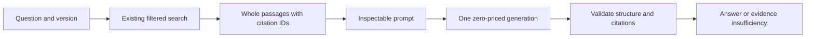

# Direct baseline RAG

**The direct baseline RAG is verified working end to end.** On 2026-10-29, the user's saved four-case development run produced two supported-question answers and two appropriate insufficient-evidence responses, all structurally valid and reporting zero model cost. The implementing assistant reviewed the actual claims, citations, and evidence; `copy2` qualification and citation placement need improvement. This is limited development validation, with no independent human review or broad accuracy claim. See [the live review](../evals/generation-dev-review.md).

The existing retriever, chunks, embedding configuration, and SQLite index are reused without rebuilding or tuning. LangGraph, query rewriting, hybrid search, reranking, comparisons, and a web interface remain later work.

## Setup and model choice

The default is the explicit model `nvidia/nemotron-3.5-super-vl:free`. On 2026-10-28, [OpenRouter's public model catalog](https://openrouter.ai/api/v1/models) reported `prompt: "0"`, `completion: "0"`, a 1,000,000-token context, and JSON-schema support. Its [official model page](https://openrouter.ai/nvidia/nemotron-3.5-super-vl:free) describes document and coding use and supports disabling reasoning. Those capabilities make it a reasonable starting candidate; they do not establish answer quality for DocLens. A public-catalog snapshot is saved locally at `outputs/answers/openrouter-model-verification.json`.

Configuration lives in [generation.json](../configs/generation.json): temperature 0, 1,600 output tokens, a 24,000-byte serialized-message budget, and 45-second socket timeouts. Reasoning is disabled. Sampling at temperature 0 still does not guarantee deterministic outputs or fixed serving weights. OpenRouter can change free-model availability and serving infrastructure.

Set the environment variable in the terminal that runs DocLens. This example prompts without echoing the key or placing it in shell history:

```bash
read -rs 'OPENROUTER_API_KEY?OpenRouter API key: '; echo
export OPENROUTER_API_KEY
uv sync --extra retrieval
```

For shells without zsh's prompt syntax, use your shell's secure input mechanism or environment manager. The variable's placeholder name is `OPENROUTER_API_KEY`; obtain its value from your OpenRouter account. Do not paste real keys into source files, commands saved in history, reports, or chat. `.env` files are ignored by Git but are **not automatically loaded**. No extra generation SDK/dependency is required.

Each generation verifies the selected model's current catalog prices before posting. Only explicit `provider/model:free` IDs are accepted. The request sets zero prompt/completion/request price caps, disables provider fallbacks, supplies no alternate models or paid routing, and requires support for the requested parameters. Context transforms are disabled. A missing model, changed price, unsupported parameter, or unavailable provider fails; the client never substitutes a paid model. `--model OTHER/EXPLICIT:free` or the configuration file selects another model, which must pass the same checks. A returned base/canonical model ID is accepted only for the requested model; requested and returned identifiers are both recorded.

Free endpoints have shared capacity, rate limits, account restrictions, and possible downtime. See [OpenRouter's limits](https://openrouter.ai/docs/api/reference/limits); limits can change and account counters are available through its key endpoint. DocLens makes one catalog request and at most one completion request per answer, with no automatic retries. Socket timeouts bound stalled operations; they are not a strict overall wall-clock deadline. Response bodies and output tokens are capped. Authentication, rate limiting, availability, malformed bodies, interruption, and abnormal finish reasons produce readable errors with a nonzero CLI exit. Raw provider error bodies are discarded. A timeout does not establish whether the remote provider completed processing.

## What leaves your machine

Generation sends the question, requested product/version, selected passage text, source IDs, headings, anchors, passage hashes, and system instructions to OpenRouter and its selected provider. It does not send the full corpus, vectors, raw HTML files, evaluation reference answers, or held-out questions. The API key travels only in the OpenRouter authorization header; catalog preflight is unauthenticated. HTTPS verification stays enabled and redirects are refused.

The selected [free endpoint's data notice](https://openrouter.ai/nvidia/nemotron-3.5-super-vl:free) says session data is logged for security and product improvement and prohibits uploading confidential or personal information. Use public documentation and non-sensitive questions. This baseline does not promise zero retention. Local JSON outputs contain questions, evidence, and answers; inspect them before sharing. Credential-like strings and the configured API key are blocked from prompts/provider outputs, and arbitrary provider usage/error strings are not saved. These checks are not a general personal-data detector.

## Run and inspect

With the existing local model cache and index:

```bash
# Supported by the indexed Python 3.13 documentation
uv run --extra retrieval python -m doclens ask "How do I create a path from a file URI?" --version 3.13

# Missing from this corpus; an appropriate answer should decline to guess
uv run --extra retrieval python -m doclens ask "What Kubernetes CPU and memory resource limits should I set for a DocLens deployment?" --version 3.13

# Exact messages, citation map, hashes, omitted passages, and settings; no provider API call
uv run --extra retrieval python -m doclens ask "How do I create a path from a file URI?" --version 3.13 --inspect-prompt

# Structured answer plus evidence and generation metadata
uv run --extra retrieval python -m doclens ask "How do I create a path from a file URI?" --version 3.13 --json
```

`--inspect-prompt` needs no key or provider network. Local retrieval still loads the cached embedding model; it does not download a model or mutate ingestion/index files. Inspection prints JSON whose `prepared.messages` array contains the exact message strings passed to the client. `prepared.evidence` is the trusted local citation map. The local metadata includes full source and passage hashes, chunk/source IDs, source/version URLs, decoded anchors, headings, retrieval scores, and embedding identifiers. `--top-k` defaults to five and is limited to 1–20. `--config` and `--index` select explicit files. `ask` writes only to stdout/stderr.

## How the code works



1. [prepare_question in answers.py](../src/doclens/answers.py) calls the existing read-only `search_index`. SQL filtering selects the requested product/version before ranking. The answer layer checks scope again, verifies passage hashes and source/citation URLs, and rejects mixed versions before generation.
2. `assemble_evidence` gives passages local IDs `E1`, `E2`, etc. It keeps a rank-prefix of **whole** passages within the serialized UTF-8 message budget. It never cuts code or prose. Omitted chunk IDs are explicit. If the first passage cannot fit, the command fails and asks for an explicit budget change. No lower-ranked passage replaces a larger higher-ranked passage.
3. The system prompt requires evidence-only factual claims with nearby citation markers, intact code formatting, named gaps, and a strict four-field JSON response. Question/evidence JSON is separate from system instructions. Documentation is untrusted data; prompt separation reduces confusion but is not a security proof against prompt injection. No tools are exposed to the model.
4. [OpenRouterClient in generation.py](../src/doclens/generation.py) performs price/capability preflight, checks context/output reservations, and sends one non-streaming chat-completions request. The byte count plus schema/framing allowance is a conservative admission estimate, **not an exact model-token count**. Provider context rejection is an error; the client never retries with truncated text. Settings, requested/returned model, price-check time, latency, finish reason, and available numeric usage/cost are recorded. Reported nonzero cost is treated as an error even after zero-price request constraints.
5. `validate_answer` parses the strict JSON and rejects duplicate/extra fields, invalid statuses, unknown or mismatched citation IDs, wrong-version citations, model-authored HTTP/Markdown links, unclosed code fences, and uncited substantive answers. Truncated/filtered/failed completions are rejected before display. `Generator`/`Completion` form the small injectable interface used by offline doubles.
6. `display_answer` resolves sources from the retrieved metadata. The model supplies IDs, never source links. The typed `AnswerResult` contains the status, text, cited passages, missing-evidence list, full prepared evidence/prompt, and generation metadata. JSON output exposes those records directly.

The statuses have deliberately different meanings:

| Status | Meaning and structural requirements |
| --- | --- |
| `answered` | Model judges the evidence sufficient for the whole answer; nonempty answer/citations, no declared missing evidence. |
| `partial` | A useful supported part is available; nonempty answer/citations and explicit missing evidence. |
| `insufficient_evidence` | No useful supported answer is available; no factual answer or citations. The renderer supplies a standard explanation and displays the stated gap. |

Zero supplied passages yields local insufficiency without a provider call. With passages, the model judges sufficiency without an arbitrary similarity cutoff. API/authentication failures and invalid responses remain errors and never become abstentions.

## Evaluation and limitations

```bash
# Prepare the fixed four-case dev sample without calling the provider
uv run --extra retrieval python -m doclens evaluate-answers --inspect-prompt

# After configuring the key: at most four completions, stopping at the first error
uv run --extra retrieval python -m doclens evaluate-answers

uv run python -m unittest discover -s tests -v
```

Reports are timestamped under ignored `outputs/answers/`; `--output` must remain inside that directory. The fixed IDs are `dev-001` (supported URI), `dev-014` (copy comparison), `dev-004` (3.12 conversion evidence gap), and `dev-023` (Kubernetes outside corpus). Reference labels remain unchanged and are not sent to the model. The runner reads only `evals/dev.json`, checks its corpus provenance, records prompt/index/code hashes and outputs/errors, and leaves separate semantic-review fields pending. It never opens held-out labels or replaces retrieval reports. Preserve individual runs when reviewing later changes.

The four saved outputs now have a separate [qualitative assistant review](../evals/generation-dev-review.md); their original JSON review fields are left unchanged. The successful run covers `answered` and `insufficient_evidence`; live `partial` behavior remains unexercised. Existing missing-key and prompt-only reports are retained as history.

Review **correctness**, **claim support**, **citation quality/coverage**, and **appropriate abstention/false abstention** separately. Valid IDs do not prove entailment, and requiring at least one citation does not prove every factual claim was cited. In the live sample, the URI answer puts citations only at the end, with a general-context citation beside more specific claims. The copying answer gives the right main distinction but omits the supplied explicit platform/metadata limits. Code-fence checks do not prove generated code behaves correctly. Sufficiency judgments can fail; nearest neighbors can be irrelevant, and missing retrieval never proves a feature absent. A release-note document can mention older versions. The small assistant-authored development set and reviews are not independent human validation or broad accuracy estimates. LangGraph remains a proposed learning unit, not an implemented feature.
