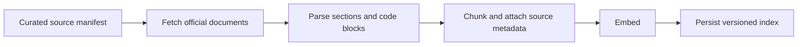
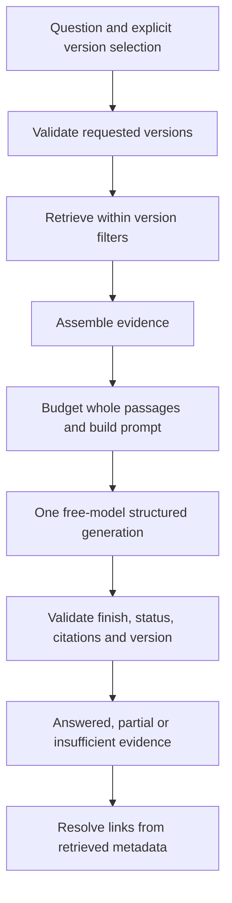

# Planned architecture

This document describes the implemented baseline and later design. Ingestion, chunking, local embedding, indexing, version-filtered retrieval, retrieval evaluation, and the direct answer pipeline are implemented. `ask` and the bounded `evaluate-answers` development sample have run successfully with the configured OpenRouter free model. A 2026-10-29 review of four saved outputs verifies a working end-to-end direct RAG baseline, with known qualification/citation issues and limited quality evidence. Development labels/scores remain provisional pending independent human review; held-out retrieval/generation have not been run. LangGraph remains planned. See [the answer pipeline](answers.md), [live semantic review](../evals/generation-dev-review.md), and [evaluation design](../evals/README.md).

## Indexing

Preserve product, release, document type, canonical URL, section anchor, title, fetch time, and content hash. Stable source and chunk identifiers make repeat ingestion and document updates inspectable. Preserve code and heading structure during parsing. Retain raw downloads locally for debugging.

The current chunker uses a 2,000-character target including heading/anchor context, without crossing section/anchor groups or adding overlap. It splits oversized prose and preserves oversized structured blocks intact with a flag. IDs fingerprint source identity, policy, context, and passage content, while provenance separately records the raw snapshot and parsed document hashes. Re-running replaces each source's current chunk bundle. The index rebuild follows the current manifest and replaces its complete snapshot, refreshing payloads and removing old IDs/sources. It does not reuse previous embeddings incrementally.

The dense baseline uses a pinned local ModernBERT encoder, explicit query/document prefixes, token preflight without truncation, and normalized 768-dimensional vectors. SQLite applies product/version constraints before selecting rows to score by exact cosine similarity. Queries open the saved index read-only and use cached model files and the index's saved configuration. Search does not mutate ingestion outputs or the index.

## Retrieval and answers

The baseline is a direct Python pipeline, with no rewriting, fallback, or automatic retry. Generation errors remain distinct from evidence insufficiency. Prompt-only inspection skips provider calls. Question/evidence data is separate from system instructions; the documentation is untrusted reference material. Passages retain exact text/code whitespace and provenance. A rank-prefix fits an explicit byte budget without cutting blocks; omitted IDs are reported. Generation checks the public model catalog and sends zero-price caps with provider fallbacks disabled. Its socket timeout, response size, context admission estimate, and output cap are explicit.

Add LangGraph only later when conditional retrieval and version comparisons need explicit state and routing. Keep the baseline retriever available for experiments. A future rewrite path must have a documented retry bound; it is not present in this diagram or implementation.

With supplied passages, the model chooses answered/partial/insufficient; zero passages produce local insufficiency. The four-case review observed two appropriate abstentions; broader calibration remains open. A similarity threshold or an LLM judgment is not proof that evidence supports an answer. The validator requires citations for substantive answers, checks IDs/versions, and rejects invented links and malformed/truncated outputs. These structural checks do not prove entailment or complete citation coverage: the live review found late/grouped citations and an incomplete preservation caveat despite valid IDs. Report uncertainty and evaluate the decision independently.

The [first proposed LangGraph unit](langgraph-first-step.md) would express this existing single-release workflow as typed state and nodes, retaining prompt inspection, zero-evidence handling, and terminal errors. This would add inspectable orchestration; it would preserve the current retrieval, generation, and validation behavior. No graph, retry loop, or comparison implementation has been added.

For comparisons, retrieve evidence separately for each requested release. Do not infer that a feature is absent merely because search returned no passage. Show which version each claim describes and where evidence is missing.

## Design choices to validate

1. Use official, explicitly versioned documents from one product to keep labeling manageable.
2. Build and measure dense retrieval before adding hybrid search or a reranker.
3. Apply version constraints before selecting retrieval candidates.
4. Keep ingestion explicit and repeatable; answering questions must not silently mutate the index.
5. Bound query rewriting and log the retrieval path so failures can be reproduced.
6. Treat retrieved text as untrusted evidence and keep instructions separate from it.

## Citation checks

Programmatic checks can verify that a citation refers to a retrieved chunk, has a valid source URL, and matches the selected version. Claim support requires a separate evaluation against the source passage. A valid citation identifier alone does not establish factual grounding.

## Components to choose during implementation

The baseline embedding/storage choices are recorded in `configs/retrieval.json`, `uv.lock`, and index metadata. The generator is OpenRouter's explicit `nvidia/nemotron-3.5-super-vl:free` route, configured in `configs/generation.json`; its setup, cost safeguards, data disclosure, and verification limits are in [the answer guide](answers.md). The reranker and user interface remain undecided. Record future choices with cost, local resource needs, and reproducibility in mind.
