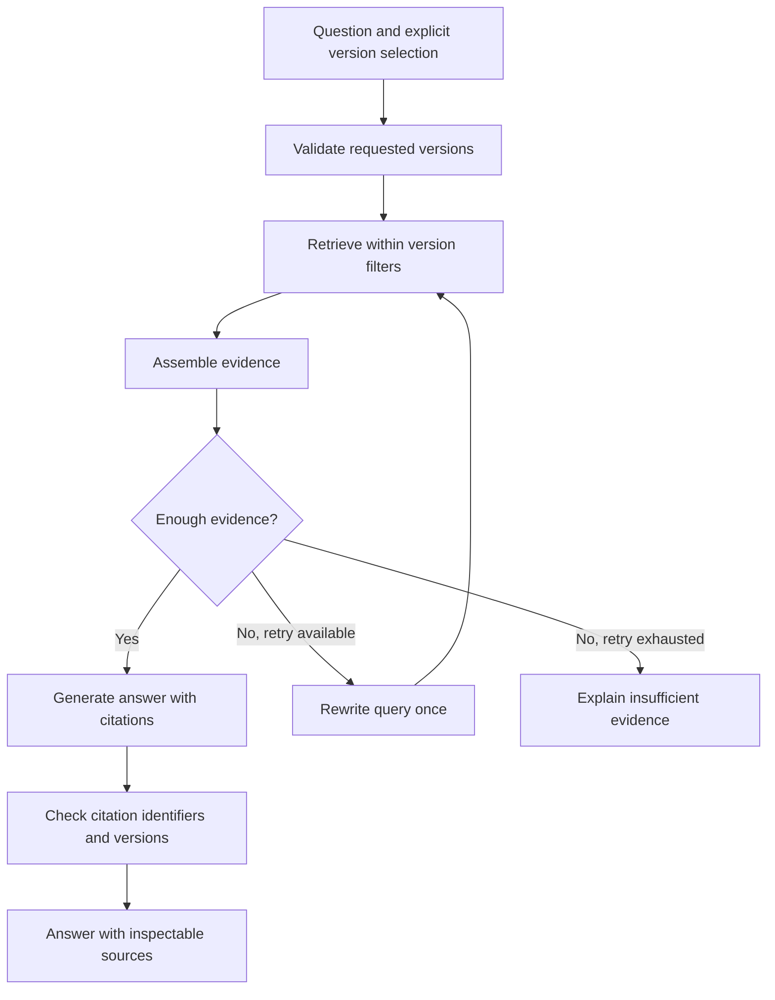

# Planned architecture

This document describes the target design. Ingestion, chunking, local embedding, persistent indexing, and version-filtered retrieval are implemented for 20 curated Python documentation pages. `doclens ingest` downloads/parses sources, `doclens chunk` exposes passages, `doclens index` builds a complete SQLite snapshot, and `doclens search` returns evidence within an explicit version. Answer generation and LangGraph remain planned. See the README, [corpus review](corpus.md), [chunking guide](chunking.md), and [retrieval guide](retrieval.md) for the validated scope.

## Indexing

Preserve product, release, document type, canonical URL, section anchor, title, fetch time, and content hash. Stable source and chunk identifiers make repeat ingestion and document updates inspectable. Preserve code and heading structure during parsing. Retain raw downloads locally for debugging.

The current chunker uses a 2,000-character target including heading/anchor context, without crossing section/anchor groups or adding overlap. It splits oversized prose and preserves oversized structured blocks intact with a flag. IDs fingerprint source identity, policy, context, and passage content, while provenance separately records the raw snapshot and parsed document hashes. Re-running replaces each source's current chunk bundle. The index rebuild follows the current manifest and replaces its complete snapshot, refreshing payloads and removing old IDs/sources. It does not reuse previous embeddings incrementally.

The dense baseline uses a pinned local ModernBERT encoder, explicit query/document prefixes, token preflight without truncation, and normalized 768-dimensional vectors. SQLite applies product/version constraints before selecting rows to score by exact cosine similarity. Queries open the saved index read-only and use cached model files and the index's saved configuration. Search does not mutate ingestion outputs or the index.

## Retrieval and answers

Begin with a direct Python pipeline. Add LangGraph when conditional retrieval and version comparisons need explicit state and routing. Keep the baseline retriever available for experiments.

The evidence-sufficiency decision will need calibration and evaluation. A similarity threshold or an LLM judgment is not proof that evidence supports an answer. Report uncertainty and evaluate the decision independently.

For comparisons, retrieve evidence separately for each requested release. Do not infer that a feature is absent merely because search returned no passage. Show which version each claim describes and where evidence is missing.

## Design choices to validate

1. Use official, explicitly versioned documents from one product to keep labeling manageable.
2. Build and measure dense retrieval before adding hybrid search or a reranker.
3. Apply version constraints before selecting retrieval candidates.
4. Keep ingestion explicit and repeatable; answering questions must not silently mutate the index.
5. Bound query rewriting and log the retrieval path so failures can be reproduced.
6. Treat retrieved text as untrusted evidence and keep instructions separate from it.

## Citation checks

Programmatic checks can verify that a citation refers to a retrieved chunk, has a valid source URL, and matches the selected version. Claim support requires a separate evaluation against the source passage. A valid citation identifier alone does not establish factual grounding.

## Components to choose during implementation

The baseline embedding/storage choices are recorded in `configs/retrieval.json`, `uv.lock`, and index metadata. The LLM provider, reranker, and user interface remain undecided. Record future choices with cost, local resource needs, and reproducibility in mind. Add infrastructure when a measured requirement justifies it.
