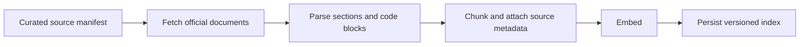
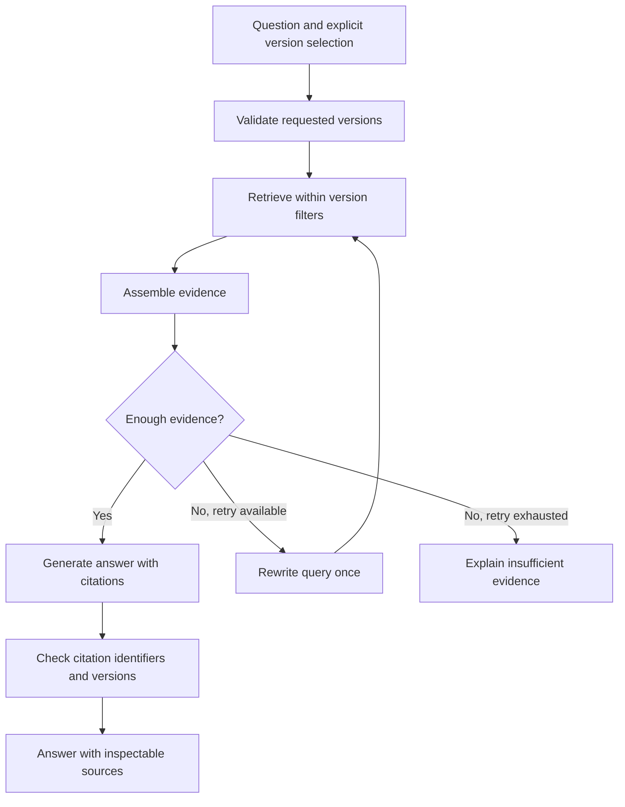

# Planned architecture

This document describes the target design. The manifest reader and HTML downloader are implemented; parsing, indexing, retrieval, and answers remain planned. The downloader saves raw bytes with source metadata, fetch time, and a content hash. See the README for the command and file layout.

## Indexing

Preserve product, release, document type, canonical URL, section anchor, title, fetch time, and content hash. Stable source and chunk identifiers make repeat ingestion and document updates inspectable. Preserve code and heading structure during parsing. Retain raw downloads locally for debugging.

## Retrieval and answers

Begin with a direct Python pipeline. Add LangGraph when conditional retrieval and version comparisons need explicit state and routing. Keep the baseline retriever available for experiments.

The evidence-sufficiency decision will need calibration and evaluation. A similarity threshold or an LLM judgment is not proof that evidence supports an answer. Report uncertainty and evaluate the decision independently.

For comparisons, retrieve evidence separately for each requested release. Do not infer that a feature is absent merely because search returned no passage. Show which version each claim describes and where evidence is missing.

## Design choices to validate

1. Use official, explicitly versioned documents from one product to keep labeling manageable.
2. Build and measure dense retrieval before adding hybrid search or a reranker.
3. Apply version constraints before selecting retrieval candidates.
4. Keep ingestion explicit and repeatable; answering questions must not silently mutate the index.
5. Bound query rewriting and log the retrieval path so failures can be reproduced.
6. Treat retrieved text as untrusted evidence and keep instructions separate from it.

## Citation checks

Programmatic checks can verify that a citation refers to a retrieved chunk, has a valid source URL, and matches the selected version. Claim support requires a separate evaluation against the source passage. A valid citation identifier alone does not establish factual grounding.

## Components to choose during implementation

The embedding model, storage adapter, LLM provider, reranker, and user interface are intentionally undecided. Record the final choices with cost, local resource needs, and reproducibility in mind. Avoid introducing infrastructure that the first milestone does not need.
