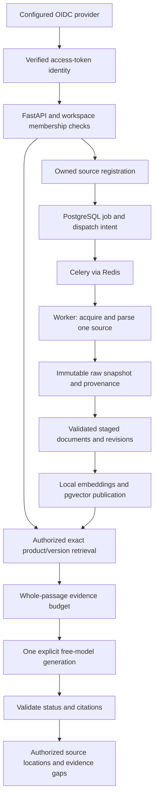
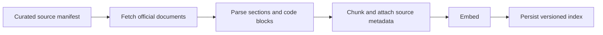
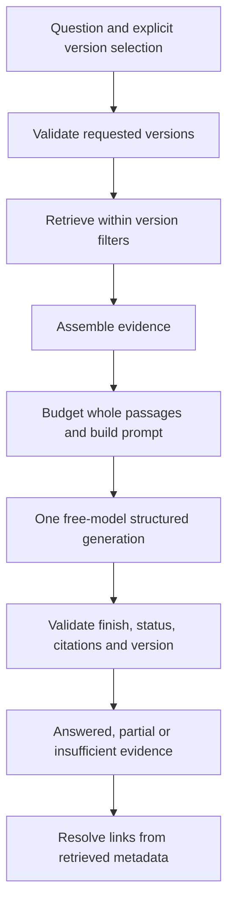

# Architecture: implemented baseline and planned service

## Expanded service — Stage 1 implemented, later paths planned

The 2026-11-02 direction is a version-aware, permission-aware engineering support and incident knowledge assistant. Stage 1 now implements an optional authenticated API for workspace/source registration/list/read against a separate PostgreSQL schema, with actual Keycloak-issued service-account/JWKS verification. Worker/broker, new source adapters, expanded retrieval/answers and the public visitor path remain planned. The CLI/SQLite RAG pipeline below stays the reference. See the [Stage 1 code/verification guide](stage1-workspaces.md), [expanded plan](expanded-rag-plan.md) and [acceptance contract](expanded-rag-plan.md#stage-1-acceptance-contract). Further LangGraph expansion waits until expanded direct RAG works and is evaluated.

The local Stage 1 setup has an API plus digest-pinned PostgreSQL 18.6 and Keycloak 26.8.1 containers on loopback ports. Restricted API credentials and operator/migration credentials are separate. Celery/Redis belongs to Stage 2; no raw acquisition occurs yet. A local raw-artifact store is sufficient initially; an object-storage SDK is chosen only if deployment requires it. The first service adds only its needed optional dependencies, leaving existing locked versions unchanged.

The 2026-11-03 clarification makes useful public reading and inspectable engineering parallel goals. The recommended first collection serves Python developers maintaining file-processing tools on 3.12/3.13, with [five proposed questions and required evidence](expanded-rag-plan.md#public-questions-and-required-evidence). This is a recommendation, not a selected cloud-native pivot. Visitors should understand the purpose, try a real question, inspect citations and supplied passages, then optionally choose a visibly synthetic guided collection. No such web experience is implemented yet. Visitor usefulness/semantic support need their own walkthrough/review evidence in addition to backend tests.

The diagram combines implemented authentication/registration with later ingestion/retrieval/answer paths; it is not a claim that every node runs. Stage 1 ends at authorized registration/list/read; Stage 2 adds one recoverable ingestion path, Stage 3 adapters, Stage 4 retrieval and Stage 5 generation. Basic configuration, tests, migrations, and safe logs begin with their feature; Stage 8 verifies full startup/recovery and operational limits.

### Trust and ownership

The configured issuer and allowed algorithms establish how PyJWT verifies a token; untrusted token headers cannot choose the issuer/key URL or verification policy. Require the configured audience, expiry, subject, issuer and access-token profile. Use `(issuer, subject)` as external identity and current PostgreSQL memberships/roles for workspace access. FastAPI dependency injection wires these checks together but does not supply the policy. A requested workspace/source ID or a valid signature alone grants no access.

Owner/editor can register sources and viewer can read them. The implemented workspace endpoints require current authenticated membership; workspace/source IDs and body ownership fields grant no permission. Stage 1 deliberately uses scoped SQL joins with no RLS. `doclens_app` can SELECT metadata and INSERT sources but cannot write memberships/workspaces or schema DDL, and is not a table owner/superuser/BYPASSRLS role. Its credentials remain trusted service credentials: direct DB reads are not row-isolated. RLS would need its own owner/bypass/pool-context tests later. Upstream per-user/group restrictions must be supported explicitly or a future source rejected/quarantined; normalization cannot silently widen them. Future workers need appropriately restricted roles too.

Public reference collections may later be shared through explicit publication/read grants. A curator's workspace can own a public collection without exposing all its sources or granting visitors write access. Workspace collection configuration, saved investigations/annotations and private/team documents retain ownership. For later public routes, the server derives a read-only context for currently published collection revisions; visitor-supplied collection/workspace IDs do not create permission. Filter default public versus deliberately selected guided/scenario collections before ranking. Synthetic labels must survive evidence/prompt/display/export paths; a public demo switch is not a private isolation check.

The eventual visitor path can read the published public collection without mandatory sign-in, under explicit request/model budgets, quotas and abuse controls. Private source/job/artifact/administration routes remain authenticated/authorized. Public answer/evidence/citation routes need their own tests in the retrieval/answer stages; this clarification adds no anonymous endpoint in Stage 1. Provider credentials stay server-side and current privacy/free-routing safeguards apply to both paths.

Apply authorization to every source/job/artifact endpoint and current published-revision retrieval. Tenant/access/product/version constraints apply before ranking/top-k. Recheck access before sending evidence to the provider and before response/source resolution; do not expose machine paths, unauthorized content/counts, or invented links. Membership/source revocation checks stay independent of stored embeddings, so content refresh delays do not grant continued access. Future caches/traces must preserve these boundaries.

### Records, source adapters, and revision lifecycle

Source acquisition (HTTPX, GitPython, local export), format parsing (Beautiful Soup, markdown-it-py, Docling, Pydantic ticket validation), and document purpose/authority/status are distinct. Suitable LangChain integrations can supply reusable loading/splitting components. Thin application adapters must preserve source locations, code/table structure, provenance, workspace/access scope, product/version applicability, immutable revision/hash and processing configuration. Reuse the proven Python/Sphinx adapter; generic loader output is not automatically equivalent.

Formats follow the selected evidence. Initial candidates are public reference/release-note HTML, revision-pinned repository snippets/Markdown/configuration examples where useful, and curated issue JSON. Add Docling/PDF only when a valuable source justifies it; no required synthetic PDF or source quota. Public issue dates/release scope/comments and source terms need curation; a closed issue or a repository test is not proof of a general fix. Optional synthetic runbooks/tickets are isolated guided/test collections, not default official guidance.

Use separate, explicitly named service schemas and database migrations. A proposed record family is SourceRegistration → immutable SourceRevision → normalized Document/Section/Block → Chunk/Embedding. Each relation retains workspace ownership; uniqueness/foreign keys prevent cross-workspace attachments. Metadata distinguishes source terms, authority, active/superseded status and synthetic fixtures. Product release, source revision, fetch time and content hash mean different things. Full incremental update/reuse/publication rules belong to Stage 6, while initial job/revision consistency starts in Stage 2.

Stage 2 records a job and dispatch intent transactionally in PostgreSQL, uses Celery for delivery/execution, and reconciles missed dispatch and repeated execution against DB state. Bound retries and attempts; do not promise exactly-once behavior. Save a hash-verifiable immutable raw artifact and staged normalized output before publishing ready content. A failed attempt cannot expose a partial revision or erase the previous usable publication. In Stage 6, content and processing-configuration changes govern reuse; confirmed deletion/access revocation are distinct from acquisition failure.

### Expanded retrieval, answers, and citations

Keep Sentence Transformers and its pinned encoder contract initially. PostgreSQL/pgvector adds exact authorized vector queries without a separate vector database; ANN needs measured filtered recall/latency justification. Preserve the SQLite reference and results. PostgreSQL full-text search is the initial later lexical candidate; its built-in ranking is not called BM25.

The expanded answer path stays direct Python. An OpenAI SDK adapter explicitly targets OpenRouter behind the existing Generator protocol, with tested extra provider fields, timeouts and `max_retries=0`. Current zero-price/capability checks, explicit `:free` model, zero-price caps, disabled paid fallback, redaction, model/usage/latency/finish checks, structured statuses, and bounded budgets remain application contracts. An SDK does not prove grounding or make repeated requests safe. Do not replace the current transport until adapter checks pass.

SourceLocation becomes a trusted typed location: official HTTPS page/anchor, revision-pinned repository path/line range, PDF page, or ticket/comment. Local artifacts use an authorized resolver rather than invented HTTPS destinations or raw filesystem paths. Existing page/version validation remains for the baseline and corresponding official-page adapter. Cite official API behavior and team procedures separately; expose conflicting/superseded guidance and gaps without treating a closed ticket or fresh timestamp as universal authority. Valid IDs and placement remain structural checks, not proof of semantic support.

### Preservation and current limits

Keep schema-1 documents/chunks, the Python corpus/configuration, frozen labels/held-out reservation, SQLite index and prior reports unchanged. Explicit imports into separate expanded artifacts retain original provenance; no automatic relabeling or baseline rebuild. Compatibility bridges and changed fingerprints need tests in their implementation stage. New evaluation datasets/reports identify their own corpus/schema/index/policy versions and authorization context. The [planned acceptance matrix](expanded-rag-plan.md#small-demo-corpus-and-planned-acceptance-matrix) has no measured outcomes yet.

The current free-provider RAG demonstration uses public/synthetic inputs only. Private/customer deployment requires a provider/privacy decision. CPU-heavy parsing/embedding will run in workers; async endpoints alone do not offload it. Stage 1 uses synchronous DB request handlers, safe logs, reviewed migrations and redacted errors. Verified results: 191 combined tests including 27 real PostgreSQL/Keycloak cases; 164 offline pytest tests with 27 integration skips; all 136 baseline unittest tests. These are local behavior checks, not production readiness or semantic quality. Baseline v2 live improvement and independent human review remain pending; no new model request was made.

## Baseline reference architecture — implemented scope

This document describes the implemented baseline and later design. Ingestion, chunking, local embedding, indexing, version-filtered retrieval, retrieval evaluation, and the direct answer pipeline are implemented. `ask` and the bounded `evaluate-answers` development sample have run successfully with the configured OpenRouter free model. A 2026-10-29 review of four saved outputs verifies a working end-to-end direct RAG baseline, with known qualification/citation issues and limited quality evidence. An optional single-release LangGraph workflow now reuses those components with local node traces. Graph answering is verified offline; real-index inspection runs without generation. Development labels/scores remain provisional pending independent human review; held-out retrieval/generation have not been run. Comparisons/rewrite loops remain planned. See [the answer pipeline](answers.md), [workflow](langgraph-first-step.md), [live semantic review](../evals/generation-dev-review.md), and [evaluation design](../evals/README.md).

## Indexing

Preserve product, release, document type, canonical URL, section anchor, title, fetch time, and content hash. Stable source and chunk identifiers make repeat ingestion and document updates inspectable. Preserve code and heading structure during parsing. Retain raw downloads locally for debugging.

The current chunker uses a 2,000-character target including heading/anchor context, without crossing section/anchor groups or adding overlap. It splits oversized prose and preserves oversized structured blocks intact with a flag. IDs fingerprint source identity, policy, context, and passage content, while provenance separately records the raw snapshot and parsed document hashes. Re-running replaces each source's current chunk bundle. The index rebuild follows the current manifest and replaces its complete snapshot, refreshing payloads and removing old IDs/sources. It does not reuse previous embeddings incrementally.

The dense baseline uses a pinned local ModernBERT encoder, explicit query/document prefixes, token preflight without truncation, and normalized 768-dimensional vectors. SQLite applies product/version constraints before selecting rows to score by exact cosine similarity. Queries open the saved index read-only and use cached model files and the index's saved configuration. Search does not mutate ingestion outputs or the index.

## Retrieval and answers

The baseline is a direct Python pipeline, with no rewriting, fallback, or automatic retry. Generation errors remain distinct from evidence insufficiency. Prompt-only inspection skips provider calls. Question/evidence data is separate from system instructions; the documentation is untrusted reference material. Passages retain exact text/code whitespace and provenance. A rank-prefix fits an explicit byte budget without cutting blocks; omitted IDs are reported. Generation checks the public model catalog and sends zero-price caps with provider fallbacks disabled. Its socket timeout, response size, context admission estimate, and output cap are explicit.

The optional graph makes preparation, generation, validation, and their conditional routes explicit while retaining the direct pipeline as the reference. A future rewrite path must have a documented retry bound; no rewrite loop is present in either implementation.

With supplied passages, the model chooses answered/partial/insufficient; zero passages produce local insufficiency. The four-case review observed two appropriate abstentions; broader calibration remains open. A similarity threshold or an LLM judgment is not proof that evidence supports an answer. The validator requires citations for substantive answers, checks IDs/versions, and rejects invented links and malformed/truncated outputs. These structural checks do not prove entailment or complete citation coverage: the live review found late/grouped citations and an incomplete preservation caveat despite valid IDs. Report uncertainty and evaluate the decision independently.

The [first LangGraph unit](langgraph-first-step.md) uses `WorkflowState` and prepare/generate/validate/insufficient nodes. Conditional edges end after prompt inspection, skip generation for empty evidence, or terminate on a typed error. `run_workflow` streams actual state values and node updates once, returning the final state and optionally emitting safe local summaries. API clients/configuration stay outside state; cloud tracing is explicitly disabled. Nodes permit one attempt and the runtime limits supersteps to eight. Provider failures remain separate from evidence insufficiency. No retry loop or comparison implementation has been added.

For comparisons, retrieve evidence separately for each requested release. Do not infer that a feature is absent merely because search returned no passage. Show which version each claim describes and where evidence is missing.

## Design choices to validate

1. Use official, explicitly versioned documents from one product to keep labeling manageable.
2. Build and measure dense retrieval before adding hybrid search or a reranker.
3. Apply version constraints before selecting retrieval candidates.
4. Keep ingestion explicit and repeatable; answering questions must not silently mutate the index.
5. Bound query rewriting and log the retrieval path so failures can be reproduced.
6. Treat retrieved text as untrusted evidence and keep instructions separate from it.

## Citation checks

Current preparation records `evidence-grounding-v2`. The generator instructions preserve relevant warnings/qualifiers and require local paragraph/list/code citations. The v2 validator enforces this Markdown format while keeping errors separate from insufficiency. Legacy unversioned prepared inputs retain their prior replay rules; the archived live report remains unchanged. The format check can reject an uncited earlier paragraph but cannot detect a missing semantic qualification or an irrelevant citation. See [the offline audit](../evals/grounding-v2-dev.md); live v2 semantic validation is pending.

Programmatic checks can verify that a citation refers to a retrieved chunk, has a valid source URL, and matches the selected version. Claim support requires a separate evaluation against the source passage. A valid citation identifier alone does not establish factual grounding.

## Components to choose during implementation

The baseline embedding/storage choices are recorded in `configs/retrieval.json`, `uv.lock`, and index metadata. The generator is OpenRouter's explicit `nvidia/nemotron-3.5-super-vl:free` route, configured in `configs/generation.json`; its setup, cost safeguards, data disclosure, and verification limits are in [the answer guide](answers.md). The reranker and user interface remain undecided. Record future choices with cost, local resource needs, and reproducibility in mind.
