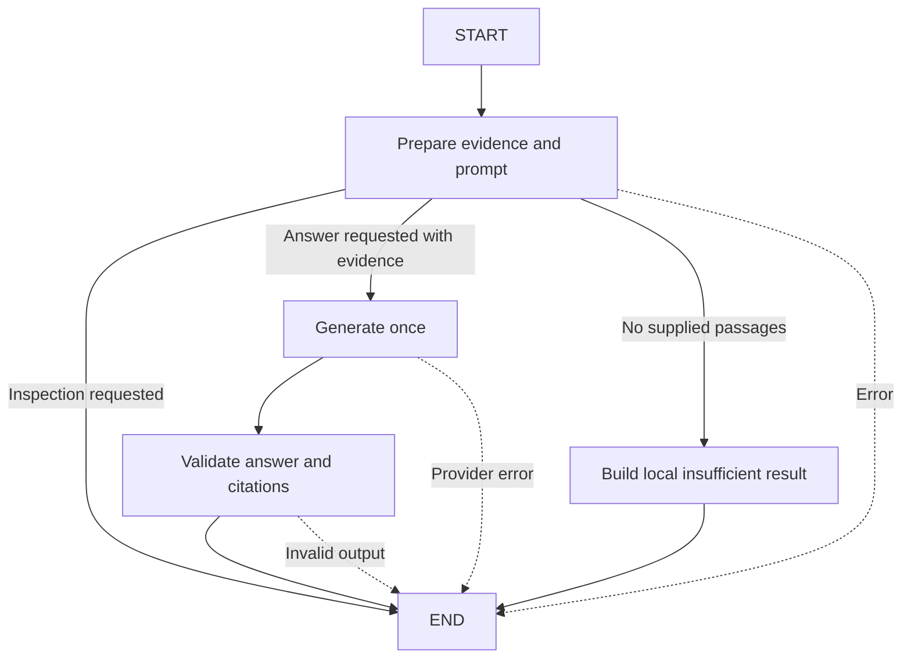

# Proposed first LangGraph learning unit

This is an explanation and implementation proposal, requested after reviewing the working direct RAG baseline. **No LangGraph dependency, graph code, or new command has been added.** Retrieval experiments, query rewriting, comparison answers, persistence, and a web interface remain later work.

The first useful unit is **an inspectable single-release workflow using the existing components**. The deliverable would be the same question/evidence/answer contract, with visible node execution and an explicit prompt-inspection branch. This makes state, nodes, edges, and termination concrete before introducing loops or multiple versions.

## State, nodes, and edges

State is the record passed between stages. A `TypedDict` would describe the input question, product/version, inspection mode, `PreparedQuestion`, `Completion`, `AnswerResult`, and an optional readable error. Nodes read the fields they need and return only their updates. Normal state updates replace the corresponding fields; streamed execution updates can provide the local trace without accumulating a message history. Type annotations do not replace the runtime validation already present in DocLens.

Nodes perform work; edges decide which node runs next. The first graph would use this flow:

An early `END` still leaves the prepared prompt or error in the final state. The renderer can use the same trusted metadata as today. Error results remain distinguishable from insufficient evidence, and there is no retry edge. The whole graph permits at most one completion request; inspection permits none.

## How existing code would be reused

| Graph stage | Existing implementation | State update |
| --- | --- | --- |
| Prepare | `prepare_question()` in [answers.py](../src/doclens/answers.py), including existing search/assembly checks | `prepared` |
| Route | Small deterministic function checking inspection mode, errors, and passage presence | Next node, without calling a model |
| Generate | Injected `Generator.complete(prepared.messages, config)`; production uses [OpenRouterClient](../src/doclens/generation.py) | `completion` |
| Validate | `validate_answer(completion, prepared)` | `result` |
| No-passage outcome | Existing empty-evidence behavior of `answer_question()` | Local insufficient-evidence `result`, no provider call |
| Display | `display_answer()` or existing JSON serialization | Same visible answer/source contract |

Today `answer_question()` already bundles generation and validation. Graph nodes would call those same underlying functions separately so the intermediate completion and validation stage are visible. The direct pipeline would remain available as the reference implementation. The model client/configuration, index, embeddings, prompt text, citation rules, and budgets would be reused. The API key and client object would stay outside graph state and streamed events, supplied through the workflow's runtime setup.

The conditional inspection branch is immediately useful: prepare the exact evidence/prompt, then finish without spending a free-model request. The no-passage branch is a defensive contract, not a semantic evidence detector. Current top-k retrieval normally returns passages even for unsupported questions; dev-004 and dev-023 still need generation followed by validation of `insufficient_evidence`. Unknown versions continue to fail clearly. No similarity threshold or graph edge establishes factual support.

## Verification for that future unit

Use an injected offline generator to compare the direct path and graph path for the same prepared input/completion: answer status/text, citation/source metadata, and error semantics should agree. Check inspection/empty-evidence paths make zero completion calls, normal generation makes one, and provider/validation failures terminate without retries. Exercise local node traces and preserve the index/ingestion/report bytes. Deterministic test doubles can establish parity; new live answers need not be identical to the saved sample.

This graph would add execution visibility and explicit routing. The observed `copy2` qualification and citation-placement problems remain answer-quality work with their own reviewed baseline. Later units can add separate per-version retrieval for comparisons or bounded retries once the basic graph is understood and explicitly requested.

Official references checked for this proposal: [Graph API and state updates](https://docs.langchain.com/oss/python/langgraph/graph-api), [conditional branching](https://docs.langchain.com/oss/python/langgraph/use-graph-api#conditional-branching), and [streaming node/state updates](https://docs.langchain.com/oss/python/langgraph/streaming#graph-state). Implementation would use `StateGraph`, explicit `START`/`END`, node updates, conditional edges, and local update streaming; library/version details should be checked when adding the dependency.
