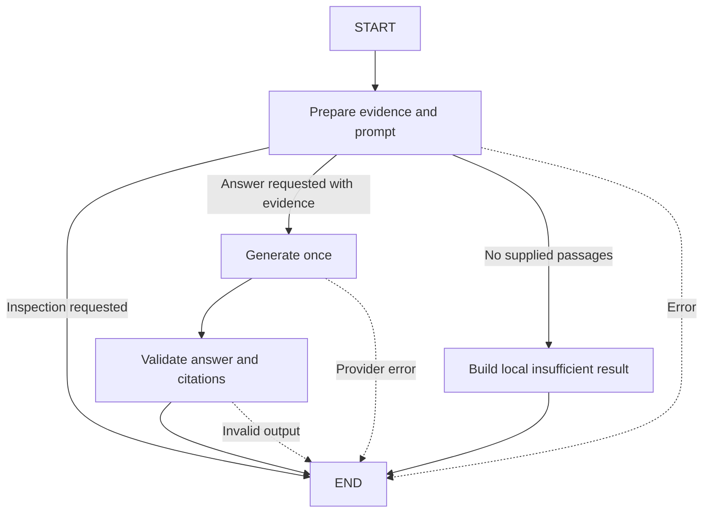

# First LangGraph unit: inspectable single-release workflow

Implemented on 2026-11-01 from the earlier proposal. The direct pipeline remains the default and the reference behavior. This unit adds typed state, explicit nodes/edges, an inspection branch, and local node traces. Retrieval experiments, query rewriting, comparison answers, persistence, and a web interface remain later work.

## Run it

Install the optional workflow and local retrieval dependencies:

```bash
uv sync --extra retrieval --extra graph

# Real evidence and exact prompt, with no provider request or key required
uv run --extra retrieval --extra graph python -m doclens ask "How do I create a path from a file URI?" --version 3.13 --workflow graph --inspect-prompt --trace

# Uses the configured OpenRouter key/model; at most one completion
uv run --extra retrieval --extra graph python -m doclens ask "How do I create a path from a file URI?" --version 3.13 --workflow graph --trace

# Structured answer on stdout, local trace summaries on stderr
uv run --extra retrieval --extra graph python -m doclens ask "How do I create a path from a file URI?" --version 3.13 --workflow graph --trace --json

# All component and graph tests, with offline generators
uv run --extra retrieval --extra graph python -m unittest discover -s tests -v
```

Omitting `--workflow graph` retains direct execution. `--trace` requires graph execution and emits JSON summaries to stderr; embedding-library notices may also use stderr. `--inspect-prompt` prints the same prompt/evidence JSON contract as direct execution. Indexing/ingestion are not invoked. Normal graph answering uses the same free-model price checks, timeouts, limits, and no-fallback client as the direct path; see [the answer guide](answers.md).

The `graph` extra locks LangGraph 1.2.19 and LangSmith 0.14.16 with their dependencies. LangSmith is used only to disable cloud tracing explicitly. No existing package version changed when adding this extra. Base ingestion/direct commands do not import LangGraph, and a missing graph extra produces a readable installation message.

## State, nodes, and edges

Read [workflow.py](../src/doclens/workflow.py) alongside this guide. `WorkflowState` is a `TypedDict` describing question/product/version, inspection mode, and the intermediate `PreparedQuestion`, `Completion`, `AnswerResult`, or `WorkflowError`. Each node returns only its changed fields. For example, prepare returns `{"prepared": prepared}`; LangGraph adds that field to the state while retaining the question/version. These fields use normal replacement updates, so no message-history reducer is needed. Type annotations do not replace the existing runtime input/evidence/output checks.

Nodes perform work; edges decide what runs next:



`_build_graph` registers the four nodes and wires the conditional routes. `_after_prepare` chooses inspection termination, generation, or local insufficiency. `_after_generate` terminates on a provider error or continues to validation. Every node has a one-attempt retry policy; there is no loop. The runtime also limits graph supersteps to eight. An early `END` leaves the prepared prompt or error in the final state.

| Stage | Existing implementation | State update |
| --- | --- | --- |
| Prepare | `prepare_question()` including version-filtered search and whole-passage prompt assembly | `prepared` |
| Generate | `Generator.complete()`; production uses the existing `OpenRouterClient` | `completion` |
| Validate | `validate_answer()` with the same status/citation/version checks | `result` |
| No-passage outcome | Existing empty-evidence behavior of `answer_question()` | Local insufficient-evidence `result`, no completion call |
| Display | Existing `display_answer()` or JSON serialization | Same answer/source contract |

The direct `answer_question()` already bundles generation and validation. Graph nodes call the same underlying functions separately so those intermediate stages become visible. Clients, encoder, filesystem paths, and generation configuration are held in node closures outside state. The API key is read by the existing client at request time and is never put in workflow configuration/state. Credential guards run before input or intermediate records enter state. Errors carry a stage, kind, and redacted message, separately from `AnswerStatus`.

The inspection branch is immediately useful: retrieve and prepare the exact prompt, then finish without a model request. The no-passage branch is a defensive contract, not an evidence-sufficiency detector. Current top-k retrieval usually returns passages even for unsupported questions; dev-004 and dev-023 still follow prepare → generate → validate before returning `insufficient_evidence`. An unknown version remains an input error. No graph edge or similarity threshold proves factual support.

## Observing execution

`run_workflow()` executes the graph once, streaming both full state values and per-node updates using the v2 event format. It returns the final actual state; an optional observer receives summaries of the updates. `_trace_update()` emits node names/updated field names, passage counts, prompt sizes/hashes, answer status/citation counts, and safe errors. Raw prompts, completions, and answer text are not printed in trace summaries. The explicit inspection/answer JSON retains its existing richer content.

`tracing_context(enabled=False)` overrides globally enabled LangSmith tracing for the execution. There is no remote tracing, checkpointer, persistent graph history, or cache. The local trace explains which nodes ran and what fields changed; it does not judge claim support.

The actual real-index inspection produced one node event:

```json
{"node":"prepare","updated_fields":["prepared"],"passages":5,"prompt_bytes":8138,"prompt_sha256":"2db6b9fc60c2331780bee26d580b149824515d519abd0ee21a096703b8ab97b5","omitted_passages":0}
```

Local outputs are saved under ignored `outputs/workflows/`: `uri-prompt-20261101.json` and `uri-trace-20261101.json`. This command used the existing cached embedding model/index and made no generation request.

## Verification and limits

The initial graph checkpoint passed 129 offline tests: 110 existing tests plus 19 workflow tests. Later RAG-policy checks bring the current suite to 136; see the [current checkpoint](progress.md). The graph checks cover answered/partial/insufficient parity, zero-call inspection/empty-evidence routes, one-call generation, terminal provider/validation/input failures, citation rejection, trace redaction, optional dependency behavior, cloud tracing disabled despite global tracing flags, CLI stdout/stderr separation, and real read-only SQLite version isolation. A clean base-only environment also passed 114 tests with 15 graph-runtime cases skipped, and verified the readable missing-extra command error before retrieval.

A separate local `outputs/workflows/parity-20261101.json` records replay of dev-001, dev-014, dev-004, and dev-023 from the user's saved successful live report. Completion fixtures were reconstructed from the saved **validated results**, not original raw provider response bytes. They retained the historical generation metadata rather than measuring new usage/latency. For each case, graph output matched the direct path and the saved validated result, using one injected completion and zero provider/retrieval calls. Both insufficient-evidence cases still traversed generate/validate because their supplied evidence was nonempty.

The original live/held-out labels, saved reports, ingestion outputs, and index were preserved. No fresh live generation or answer-quality measurement was performed for this orchestration unit. The observed `copy2` qualification and citation-placement limitations remain open. Later units can add separate per-version retrieval for comparison or a bounded retry path after their design is explained and requested.

Official references checked for the implementation: [Graph API and state updates](https://docs.langchain.com/oss/python/langgraph/graph-api), [conditional branching](https://docs.langchain.com/oss/python/langgraph/use-graph-api#conditional-branching), [streaming state/node updates](https://docs.langchain.com/oss/python/langgraph/streaming#graph-state), and [disabling cloud tracing](https://docs.langchain.com/langsmith/conditional-tracing#disable-tracing-for-a-graph).
