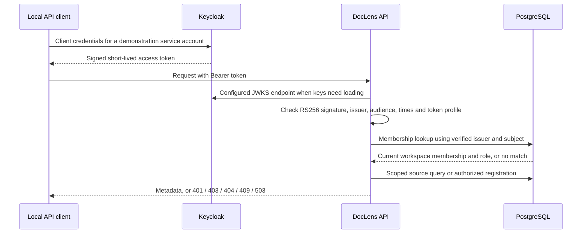

# Stage 1: authenticated workspaces and source ownership

Implemented and locally verified on 2026-11-03. This adds a small optional FastAPI service alongside the unchanged RAG CLI/SQLite baseline. It registers and reads source metadata; it does not fetch, parse, index or generate answers. The public reader, browser sign-in, new adapters and worker are later stages.

## Request flow



Keycloak owns identity issuance; DocLens owns access policy. A valid signature establishes which configured issuer signed the claims, not access to every workspace. Token roles, arbitrary workspace IDs, `jku`/`x5u` key URLs, and body ownership fields do not grant permission. The verifier takes keys only from the server-configured JWKS URL and accepts the explicit Keycloak profile: RS256, header `typ=JWT`, payload `typ=Bearer`, expected issuer/audience, and required valid subject/issued-at/expiry claims. [Keycloak endpoints](https://www.keycloak.org/securing-apps/oidc-layers), [PyJWT verification](https://pyjwt.readthedocs.io/en/stable/api.html).

The actual local identity-provider check uses six Keycloak **service accounts** and OAuth client credentials, not an interactive human login. There is no DocLens password table or password-grant endpoint. Browser sign-in would use an appropriate authorization-code/PKCE integration in a later unit. `atlas-owner`, `atlas-editor`, `atlas-viewer`, `boreal-owner`, `dual-member` and `outsider` are demonstration identities, not real visitors or organizations.

## Database and permissions

The new PostgreSQL schema is `doclens_service`; the API's record marker is `doclens-service-v1`. Neither changes baseline document/index schema 1.

| Table | Meaning and constraints |
| --- | --- |
| `principals` | UUID identity, unique `(issuer, subject)`; no password or token storage |
| `workspaces` | UUID ownership boundary with a unique slug and display name |
| `memberships` | Composite workspace/principal primary key, foreign keys, constrained owner/editor/viewer role |
| `sources` | Server-created UUID, workspace/creator foreign keys, product/version/purpose, HTTPS URL/terms, creation time; unique workspace/URL/product/version registration |

Workspaces and memberships are provisioned by the trusted local operator helper. Self-service workspace creation, invitations, membership administration and source updates/deletes are outside this stage. Owners/editors can register sources; viewers can read. A dual member can have different roles in each workspace. A new request reads current membership even if its token is still valid.

The cluster administrator provisions roles/schema. Alembic runs as `doclens_owner`, which owns the schema/tables. The API runs as `doclens_app`: no superuser/createdb/createrole/BYPASSRLS, no schema ownership, SELECT on metadata tables and INSERT on sources only. It cannot write memberships/workspaces or issue schema DDL. The test database is separately created, migrated and dropped by the test fixture; it never replaces the persistent demonstration DB or baseline SQLite index.

**Isolation is enforced by application queries in this unit.** `require_workspace()` joins the verified identity to current membership and requested workspace; source queries additionally constrain `workspace_id`, including when a caller supplies a source UUID. RLS is deliberately deferred: the runtime database credentials are trusted service credentials and can read metadata across workspaces directly. This is not database-enforced row isolation or a general security certification. There is no tenant state stored in pooled connections, and connection reuse/role differences are tested. If RLS is later added, owner/bypass and pooled-context behavior need separate tests. [PostgreSQL policy behavior](https://www.postgresql.org/docs/current/ddl-rowsecurity.html).

## API contract

| Endpoint | Behavior |
| --- | --- |
| `GET /api/v1/workspaces` | Current member's workspaces and roles only; limit/offset pagination |
| `GET /api/v1/workspaces/{workspace_id}/sources` | Sources in an authorized workspace only; pagination |
| `GET /api/v1/workspaces/{workspace_id}/sources/{source_id}` | Both workspace and source ID must match |
| `POST /api/v1/workspaces/{workspace_id}/sources` | Owner/editor registers metadata; returns 201 after DB commit |

Missing/invalid/expired/wrong-issuer/audience/type tokens return 401 with a Bearer challenge. A member with insufficient write role gets 403. Unknown/inaccessible workspace/source lookups both use 404 with the same message. Duplicate registration returns 409 and rolls back. Invalid body/query/path data returns a fixed 422 without echoing rejected input. Database and identity-provider connection failures return redacted 503 responses. Registration rejects caller-supplied scope/creator/role fields and credential-bearing/query/fragment URLs.

Source registration does not verify that a URL exists, that its license permits a particular use, or that it can be parsed. It does not resolve DNS or fetch it. The initial connector is `https_html`; metadata distinguishes purpose from format. Stage 2 must enforce allowed network destinations/redirects, response limits and parser/provenance checks when acquisition begins. No index/corpus mutation occurs while asking this service to register/list metadata.

## Libraries and exact local versions

New service dependencies are optional under `--extra service`; pytest is in the development group. `uv.lock` pins the tested resolution. No previously locked package version changed. The base CLI does not import the service package.

| Package / image | Verified version | Delegation and remaining application work |
| --- | --- | --- |
| FastAPI / Uvicorn | 0.162.0 / 0.54.0 | Routing, dependency lifecycle and ASGI serving; DocLens defines the policy/endpoints |
| Pydantic / pydantic-settings | 2.14.2 / 2.16.2 | Input/output/settings validation; application source/version/scope rules remain explicit |
| SQLAlchemy / psycopg binary | 2.1.6 / 3.3.7 | ORM, connections, transactions and PostgreSQL driver; scoped queries, role grants and ownership remain application decisions |
| Alembic | 1.20.1 | Versioned migrations; reviewed `0001_workspace_sources`, schema matches models |
| PyJWT / cryptography | 2.15.1 / 50.0.2 | Signature/claim verification and RSA primitives; configured issuer/profile and membership authorization remain DocLens's responsibility |
| HTTPX / pytest | 0.28.1 / 9.2.0 | Local client/API fixtures and assertions; real PostgreSQL/Keycloak required for integration claims |
| PostgreSQL | 18.6 Alpine | Concurrent relational persistence and constraints; separate service database, no pgvector yet |
| Keycloak | 26.8.1 | Local identity provider and JWKS; service-account flow actually exercised |

Both container images are pinned by digest in [Compose](../compose.stage1.yaml), not a floating `latest` tag. Existing custom RAG code was retained because its provenance/budget/citation contracts already have tests; no new orchestration or generator adapter was needed here. Synchronous database handlers use one session per request, close it through a context manager, and commit registrations before returning success. Adding `async def` to blocking DB/CPU work would not itself offload it. [FastAPI yield dependencies](https://fastapi.tiangolo.com/tutorial/dependencies/dependencies-with-yield/), [SQLAlchemy session lifetimes](https://docs.sqlalchemy.org/en/21/orm/session_basics.html), [Alembic migration review](https://alembic.sqlalchemy.org/en/latest/autogenerate.html).

Installed metadata identifies MIT for FastAPI/Pydantic/settings/SQLAlchemy/Alembic/PyJWT/pytest; BSD-3-Clause for HTTPX/Uvicorn; LGPL-3.0-only for psycopg/psycopg-binary; Apache-2.0 OR BSD-3-Clause for cryptography. Keycloak's image identifies Apache-2.0; PostgreSQL has its [own license](https://www.postgresql.org/about/licence/). Binary/container dependencies also carry third-party notices; this is a recorded dependency inventory, not a complete redistribution audit or legal conclusion. Docker Desktop licensing depends on the user's use/organization. The local processes consume disk/RAM/CPU; no paid service or model call is part of this stage.

## Run and inspect

Requires a running local Docker engine and Python 3.12+/uv. Run from the repository root. The preparation helper generates random development credentials in ignored local files and reuses them on repeat setup; it never displays tokens, passwords or DSNs. Keep those files with the corresponding development volumes. Realm JSON contains environment placeholders; client secrets are provided through a separate ignored env file. Keycloak's `start-dev` and loopback HTTP are development-only. [Realm import/environment substitution](https://www.keycloak.org/server/importExport), [local Keycloak container setup](https://www.keycloak.org/getting-started/getting-started-docker).

```bash
uv sync --extra service --group dev
uv run --extra service python scripts/stage1_dev.py prepare
docker compose -f compose.stage1.yaml up -d
uv run --extra service python scripts/stage1_dev.py bootstrap
uv run --extra service uvicorn doclens.service.app:create_app --factory --host 127.0.0.1 --port 18000 --env-file .env.service.local --no-access-log
```

`bootstrap` waits for local readiness, provisions restricted roles/schema, applies Alembic and seeds demonstration memberships using actually verified Keycloak identities. It is an operator command, not an API endpoint. There is no default password in source. `.env.service.local`, `.env.stage1.idp.local`, `data/service/dev/credentials.json` and the PostgreSQL secret file are ignored; do not print/commit them. The API configuration does not automatically read arbitrary `.env` files; the launch command explicitly selects its env file. Other deployments must supply HTTPS OIDC URLs; loopback HTTP requires the explicit development setting.

In a second terminal:

```bash
uv run --extra service python scripts/stage1_dev.py request /api/v1/workspaces
uv run --extra service python scripts/stage1_dev.py request /api/v1/workspaces/843909a7-d634-5b3a-a119-c747ac16ff1c/sources --method POST --body examples/service/source.json
uv run --extra service python scripts/stage1_dev.py request /api/v1/workspaces/843909a7-d634-5b3a-a119-c747ac16ff1c/sources --identity atlas-viewer
uv run --extra service python scripts/stage1_dev.py request /api/v1/workspaces/daab9391-c0ba-5805-90b6-6ce124ba0e15/sources --identity atlas-owner
```

The request helper obtains a real local token and attaches the Authorization header without displaying it. It prints HTTP status and JSON for inspection, including expected denied responses. The two IDs above are deterministic development fixture IDs. Repeating the same registration returns 409; it does not create another source. The API's `/docs` page describes the contract but is not a visitor application or a completed browser sign-in flow.

Actual saved HTTP observations in [the local report](../outputs/service/stage1-http-20261103.json):

| Request | Observed status |
| --- | ---: |
| Owner lists authorized workspaces | 200 |
| Owner registers the example source | 201 |
| Viewer reads that source | 200 |
| Viewer attempts registration | 403 |
| Atlas-only identity lists/registers Boreal source | 404 / 404 |
| Outsider requests Atlas sources | 404 |
| Missing token | 401 |
| Repeated registration | 409 |

These are real local API/PostgreSQL/Keycloak responses using synthetic identities, not invented output or independent human validation. The report contains no tokens, secrets or DSNs. Safe application logs contain method, route template and status only. Use `--no-access-log` as shown so Uvicorn does not separately log arbitrary query strings; do not enable HTTP/SQL debug logging with real credentials/content.

## Verification and limits

```bash
# All offline checks: 164 passed, integration cases skipped unless requested
uv run --extra retrieval --extra graph --extra service python -m pytest tests -q

# Real local PostgreSQL/Keycloak, with a fresh disposable test database
DOCLENS_RUN_INTEGRATION=1 uv run --extra retrieval --extra graph --extra service python -m pytest tests -q

# Original unittest suite remains available
uv run --extra retrieval --extra graph python -m unittest discover -s tests -q
```

The combined real-service run passed **191 tests**, with pytest also reporting 121 unittest subtests. This is 136 preserved baseline tests plus 28 new offline checks and 27 real-service cases. Baseline unittest execution separately passed all 136. Alembic `check` found no new upgrade operations. Negative token fixtures use generated RSA keys and the actual verifier/HTTP handler; the positive Keycloak path uses real issued tokens and configured JWKS, with no fake authentication dependency. Integration cases check persistence/roles, wrong-workspace/source IDs, body scope overrides, uniqueness/foreign keys/rollback, pagination and connection reuse, membership removal with an existing token, redaction and non-owner DB privileges. No held-out retrieval/generation or model request occurred.

Current limits: application-enforced isolation (no RLS), a Keycloak-specific token profile, local service-account identities, cached JWKS with bounded network timeouts, offset pagination, one metadata-only connector, and a development-only IdP/database setup. JWT verification is not online introspection: disabling an IdP account or ending a login session does not immediately invalidate every already-issued token. Membership changes do affect subsequent API requests. There is no browser login, anonymous public reader, refresh-token storage, source sync, content ACL lifecycle, workload/attack audit, backup/restore or production-readiness claim. Those require their respective later units and evidence.

## Trace the important code

- [settings.py](../src/doclens/service/settings.py): typed settings and secret DSN wrapper; reject SQLite and unsafe OIDC transport configuration.
- [auth.py](../src/doclens/service/auth.py): small immutable `Identity`, fixed verifier policy, cached library-managed JWKS and redacted failure types. It returns identity, not workspace grants.
- [app.py](../src/doclens/service/app.py): `Annotated[..., Depends(...)]` wires identity/session/access dependencies; membership and source filters stay in SQL. `commit()`/`rollback()` make registration outcomes explicit.
- [models.py](../src/doclens/service/models.py) and [schemas.py](../src/doclens/service/schemas.py): SQLAlchemy `Mapped` describes database fields; Pydantic validates untrusted requests and response shapes. They have different responsibilities.
- [the migration](../migrations/versions/0001_workspace_sources.py): executable reviewed schema/constraints/grants, instead of creating tables implicitly during an HTTP request.
- [the local operator helper](../scripts/stage1_dev.py) and [tests](../tests/service/test_registration.py): operator credentials stay outside API requests; test identities exercise actual issued tokens and actual scoped DB operations.

Learning checkpoint: trace one POST from bearer token to `(issuer, subject)` to membership to the committed source's creator/workspace. Then explain why the same valid token gets 403 in one workspace and can register in another. The user's explanation belongs in their own learning notes; passing tests alone does not establish their understanding.

Stop at this boundary. Stage 2 will add one persisted, recoverable ingestion workflow only after the user requests it. Stop the local API with Ctrl-C and the two containers with `docker compose -f compose.stage1.yaml stop` when finished; their development volumes remain available. No deployment or volume deletion is necessary to complete Stage 1.
